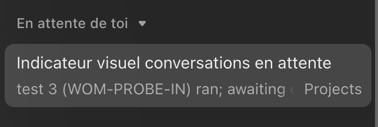
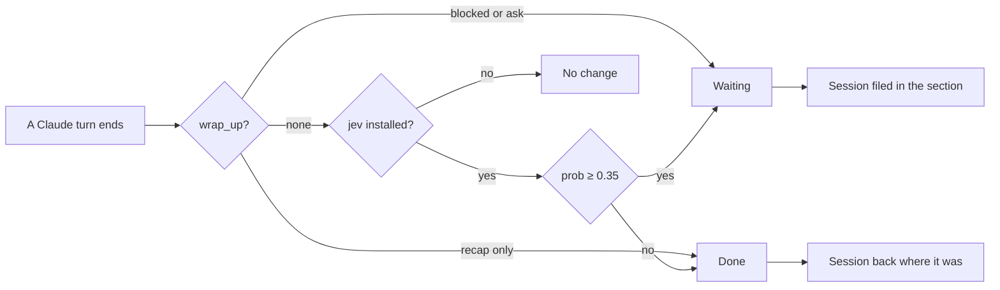

<div align="center">

[](README.md)


# waiting-on-me

**Spot at a glance the Claude sessions that wait on your answer.**<br>
A Claude Code mod that files every session ending on a question, a choice or an action for you under a sidebar section, and takes it out once the task is done.

[](LICENSE)
[](.claude-plugin/plugin.json)
[](#requirements)
[](hooks/register.ts)

</div>

<p align="center"></p>

## Why

With ten sessions open in the Code tab, the ones that stopped on "do you prefer A or B?" look just like the ones that finished. You miss them, and the task sleeps.

waiting-on-me pulls them out: they go to a dedicated section at the top of the sidebar, and stay there until a Claude turn ends with nothing pending.

## How it works



1. At the end of each turn, the mod checks whether Claude called `wrap_up`, the desktop app's end-of-turn tool. With `blocked: true` or a question (`ask`), the session waits on you. With a recap only, the task is done.
2. If Claude gave no signal and the `jev` CLI is installed, Jev reads the final message and rates how likely it waits on you. The low threshold (0.35) leans to "waiting": a false positive costs less than a forgotten question.
3. The mod moves the session with the app's `ccd_sidebar` tools, and remembers its original section to put it back later.

Opening or reading a session changes nothing. Only a turn that ends with nothing pending takes it out of the section, or you moving it by hand.

## Requirements

- The Claude desktop app, **Code** tab (the sidebar only exists there).
- A recent Claude Code with mods (hooks-module plugins).
- `python3` (for the installer).
- Optional: a `jev` CLI (not shipped here: it reads `{state, questions}` JSON on stdin and answers like OpenRouter's TypeSafe Jev API), to classify turns where Claude gave no signal.

## Install

```sh
curl -fsSL https://raw.githubusercontent.com/pyxl-dev/waiting-on-me/main/install.sh | sh
```

With your own section name:

```sh
curl -fsSL https://raw.githubusercontent.com/pyxl-dev/waiting-on-me/main/install.sh | SECTION="Needs me" sh
```

The installer:

1. installs the mod as a Claude Code plugin (user scope);
2. allows `mcp__ccd_sidebar__move_sessions` and `mcp__ccd_sidebar__create_section` in `~/.claude/settings.json`, otherwise auto mode refuses moves made from a hook;
3. adds a short rule to `~/.claude/CLAUDE.md`, between two markers, asking Claude to end with `wrap_up` and `blocked: true` when it waits on you.

It is idempotent: re-run it to update. Uninstall:

```sh
curl -fsSL https://raw.githubusercontent.com/pyxl-dev/waiting-on-me/main/install.sh | sh -s -- --uninstall
```

By hand, in a Claude Code terminal:

```
/plugin install waiting-on-me --marketplace pyxl-dev/waiting-on-me
```

Then add the two rules and the `CLAUDE.md` line described above.

## Settings

In the plugin's config menu, or with `claude plugin install ... --config key=value`:

| Option | Default | Role |
| --- | --- | --- |
| `section` | `Waiting on you` | Name of the sidebar section |
| `useJev` | `true` | Classify with `jev` when Claude gave no signal |
| `jevThreshold` | `0.35` | Probability at or above which the session counts as waiting |

## Security

- The mod only files sessions into sections. It reads none of your files and deletes nothing.
- With Jev on, the last 4000 characters of Claude's final message go to OpenRouter. Set `useJev` to `false` to send nothing.
- The two permission rules cover only moving sessions and creating sections.

## Development

```sh
git clone https://github.com/pyxl-dev/waiting-on-me
claude plugin validate waiting-on-me
```

To run it from the clone, add its path to `CLAUDE_CODE_PLUGIN_DIRS` (`:`-separated) in the `env` block of `~/.claude/settings.json`. The code fits in [`hooks/register.ts`](hooks/register.ts).

## License

[MIT](LICENSE). Made with Claude.
