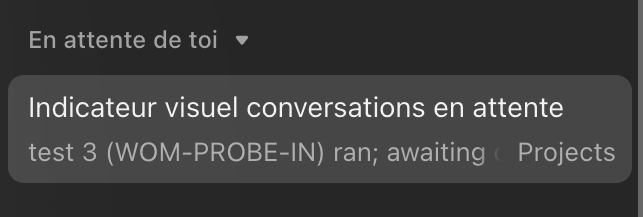
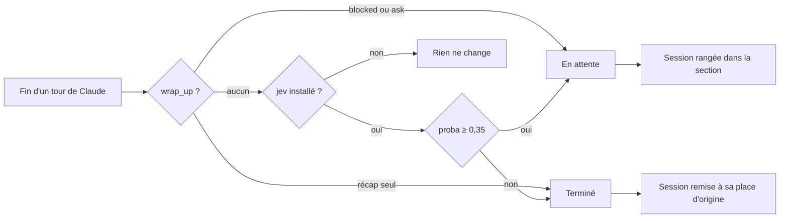

<div align="center">

[](README.en.md)


# waiting-on-me

**Repère d'un coup d'œil les sessions Claude qui attendent ta réponse.**<br>
Un mod Claude Code qui range dans une section de la sidebar chaque session qui finit sur une question, un choix ou une action à faire de ton côté, et l'en sort quand la tâche est finie.

[](LICENSE)
[](.claude-plugin/plugin.json)
[](#prérequis)
[](hooks/register.ts)

</div>

<p align="center"></p>

## Pourquoi

Avec dix sessions ouvertes dans l'onglet Code, celles qui se sont arrêtées sur « tu préfères A ou B ? » ressemblent à celles qui ont fini. Tu passes à côté, et la tâche dort.

waiting-on-me les sort du lot : elles vont dans une section dédiée en haut de la sidebar, et y restent tant qu'un tour de Claude ne finit pas sans rien en attente.

## Comment ça marche



1. À chaque fin de tour, le mod regarde si Claude a appelé `wrap_up`, l'outil de fin de tour de l'app desktop. Avec `blocked: true` ou une question (`ask`), la session t'attend. Avec un récap seul, la tâche est finie.
2. Si Claude n'a rien signalé et que la CLI `jev` (modèle TypeSafe Jev via OpenRouter) est installée, Jev lit le dernier message et estime la probabilité qu'il attende quelque chose de toi. Le seuil bas (0,35) fait pencher vers « en attente » : mieux vaut un faux positif qu'une question oubliée.
3. Le mod déplace la session via les outils `ccd_sidebar` de l'app, et mémorise sa section d'origine pour l'y remettre ensuite.

Ouvrir ou lire une session ne change rien. Seul un tour terminé sans rien en attente la sort de la section, ou toi en la déplaçant à la main.

## Prérequis

- L'app desktop Claude, onglet **Code** (la sidebar n'existe que là).
- Claude Code récent avec les mods (plugins à module de hooks).
- `python3` (pour l'installateur).
- Optionnel : une CLI `jev` (non fournie ici : elle lit un JSON `{state, questions}` sur stdin et répond comme l'API TypeSafe Jev d'OpenRouter), pour classer les tours où Claude ne s'est pas signalé.

## Installation

```sh
curl -fsSL https://raw.githubusercontent.com/pyxl-dev/waiting-on-me/main/install.sh | sh
```

Avec un nom de section à toi :

```sh
curl -fsSL https://raw.githubusercontent.com/pyxl-dev/waiting-on-me/main/install.sh | SECTION="En attente de toi" sh
```

L'installateur :

1. installe le mod comme plugin Claude Code (portée utilisateur) ;
2. autorise `mcp__ccd_sidebar__move_sessions` et `mcp__ccd_sidebar__create_section` dans `~/.claude/settings.json`, sinon le mode auto refuse les déplacements faits par un hook ;
3. ajoute à `~/.claude/CLAUDE.md` une règle courte, entre deux balises, qui demande à Claude de finir par `wrap_up` avec `blocked: true` quand il t'attend.

Il est idempotent : relance-le pour mettre à jour. Désinstallation :

```sh
curl -fsSL https://raw.githubusercontent.com/pyxl-dev/waiting-on-me/main/install.sh | sh -s -- --uninstall
```

À la main, dans un terminal Claude Code :

```
/plugin install waiting-on-me --marketplace pyxl-dev/waiting-on-me
```

Puis ajoute les deux règles et la ligne de `CLAUDE.md` comme décrit plus haut.

## Réglages

Dans le menu de config du plugin, ou avec `claude plugin install ... --config clé=valeur` :

| Option | Défaut | Rôle |
| --- | --- | --- |
| `section` | `Waiting on you` | Nom de la section de la sidebar |
| `useJev` | `true` | Classer avec `jev` quand Claude ne s'est pas signalé |
| `jevThreshold` | `0.35` | Probabilité à partir de laquelle la session compte comme en attente |

## Sécurité

- Le mod ne fait que ranger des sessions dans des sections. Il ne lit pas tes fichiers et ne supprime rien.
- Avec Jev activé, les 4000 derniers caractères du message final de Claude partent vers OpenRouter. Mets `useJev` à `false` si tu ne veux rien envoyer.
- Les deux règles de permission couvrent seulement le déplacement de sessions et la création de sections.

## Développement

```sh
git clone https://github.com/pyxl-dev/waiting-on-me
claude plugin validate waiting-on-me
```

Pour le faire tourner depuis le clone, ajoute son chemin à `CLAUDE_CODE_PLUGIN_DIRS` (séparateur `:`) dans le bloc `env` de `~/.claude/settings.json`. Le code tient dans [`hooks/register.ts`](hooks/register.ts).

## Licence

[MIT](LICENSE). Créé avec Claude.
